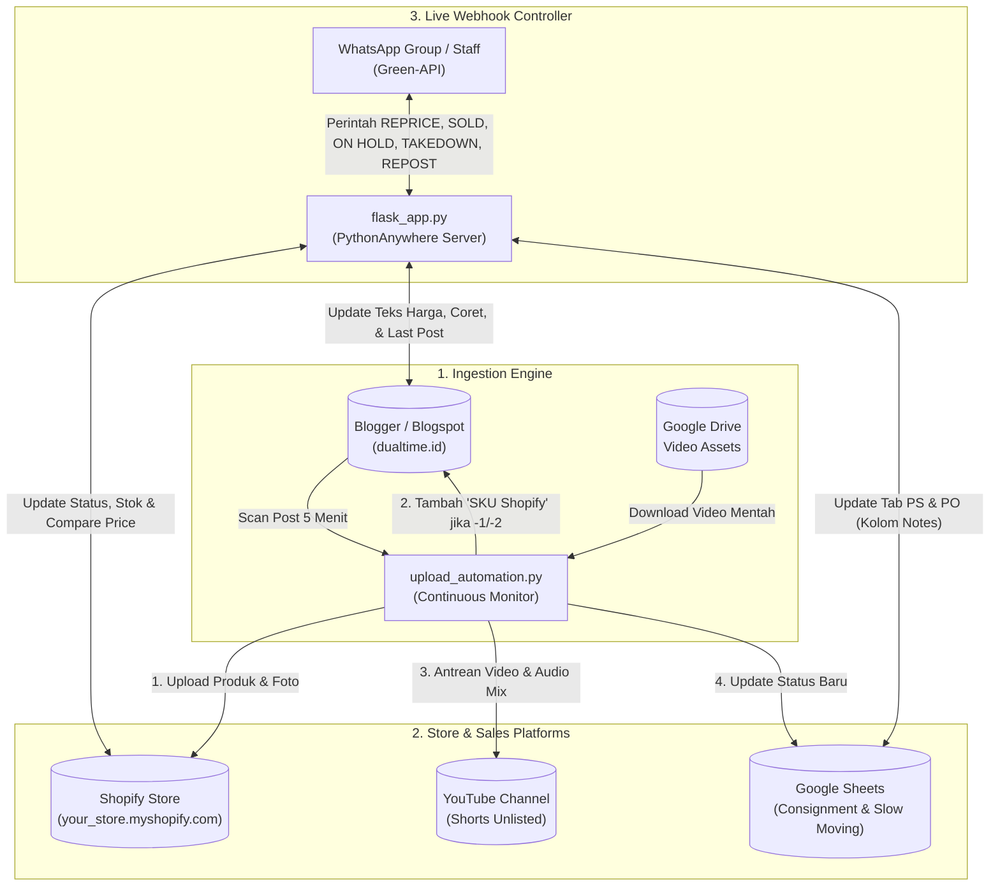
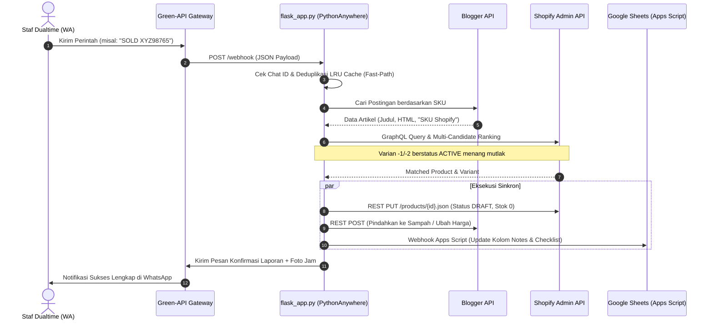

# LAPORAN TEKNIS ARSITEKTUR SISTEM & PANDUAN SETUP PYTHONANYWHERE
**Dualtime Indonesia Automation System**  
*Dokumen Spesifikasi Teknis, Alur Data, dan Prosedur Deployment*

---

## 1. Ringkasan Eksekutif (Executive Summary)

Sistem otomasi katalog dan penjualan Dualtime Indonesia terdiri dari dua subsistem utama yang saling terhubung secara terdistribusi:



1. **`upload_automation.py` (Ingestion & Upload Engine)**  
   Bertugas memonitor artikel baru di Blogspot secara otomatis setiap 5 menit, mengklasifikasikan jenis produk, mengekstrak data katalog (judul, SKU, harga, tahun, foto resolusi tinggi), mengunggahnya ke Shopify, mengunggah video ke YouTube Shorts, serta melakukan sinkronisasi balik (*reverse-sync*) penulisan `SKU Shopify: [SKU]` pada artikel Blogspot jika SKU bertanda strip (`-1`, `-2`).
2. **`flask_app.py` (WhatsApp Bot Controller & Webhook Server)**  
   Berjalan sebagai layanan web real-time (dihosting di PythonAnywhere) yang menerima perintah teks dari WhatsApp via Green-API (seperti `REPRICE`, `SOLD`, `ON HOLD`, `TAKEDOWN`, `REPOST`, dan `FOTO`), mencari produk dengan sistem pemeringkatan cerdas (*Multi-Candidate Ranking*), dan melakukan pembaruan serentak ke Shopify, Blogspot, dan Google Sheets.

---

## 2. Bedah Teknis `upload_automation.py`

### 2.1. Alur Kerja (Workflow) Utama
Script ini beroperasi dalam mode *continuous monitoring loop* (setiap 300 detik / 5 menit):

1. **Pengambilan Tautan Artikel**:
   - Memanggil Blogger API v3 (`posts().list(maxResults=20, status='LIVE')`).
   - Menyaring artikel dengan tanggal publikasi hari ini dan kemarin (WIB).
   - Memeriksa daftar tautan terhadap cache lokal `processed_urls.json`. Jika tautan sudah pernah sukses diproses, artikel langsung dilewati tanpa query ulang.
2. **Verifikasi Label & SKU**:
   - Wajib memiliki label `NEW ARRIVAL`. Jika tidak ada, proses dilewati.
   - Mengekstrak SKU dasar dari teks `Code: ...`. Jika SKU sudah ada di `PROCESSED_SKUS` hari ini, diproteksi dari pengunggahan ganda.
3. **Klasifikasi Format Katalog**:
   - `PHOTO STUDIO`: Memiliki label `CONSIGNMENT_PS` atau `FEATURED`.
   - `PHOTO OWNER`: Memiliki label `CONSIGNMENT_PO` atau SKU berawalan `CPO`.
   - `NOTSYNC`: Memiliki label `NOTSYNC`.
   - `TWP`: Memiliki label `TWP`.

---

### 2.2. Fitur Proteksi & Logika Kritis

#### A. Dual-Layer Regex Safeguard (Pencegah Salah Harga)
Untuk mencegah teks `Retail Price: Rp 200.000.000` salah diambil sebagai harga jual toko:
```python
price_match = re.search(r'(?m)^\s*Price\s*:\s*([^\n]+)', body_text, re.IGNORECASE)
if not price_match:
    price_match = re.search(r'(?<!retail\s)\bPrice\s*:\s*([^\n]+)', body_text, re.IGNORECASE)
```

#### B. Generator SKU Unik Counter Suffix (`-1`, `-2`, `-3`)
Shopify menolak SKU duplikat atau memerlukan pelacakan iterasi jam yang datang kembali:
```python
if sku in EXISTING_SKUS:
    counter = 1
    while f"{base_sku}-{counter}" in EXISTING_SKUS:
        counter += 1
    sku = f"{base_sku}-{counter}"
EXISTING_SKUS.add(sku)
```

#### C. Reverse-Sync Otomatis ke Blogspot (`insert_shopify_sku_html`)
Saat jam diunggah dengan counter suffix (misal `ABC12345-1`), script langsung mengedit konten artikel Blogspot via `posts().patch()`:
```html
<!-- Sebelum -->
<div style="font-family: Times;">Code: ABC12345 (Customer A)</div>
<div style="font-family: Times;">Last Post: 17 Nov 2026</div>

<!-- Sesudah Otomatis Disisipkan -->
<div style="font-family: Times;">Code: ABC12345 (Customer A)</div>
<div style="font-family: Times;">SKU Shopify: ABC12345-1</div>
<div style="font-family: Times;">Last Post: 17 Nov 2026</div>
```
> [!NOTE]
> Fungsi `insert_shopify_sku_html` bersifat **idempoten** dan menduplikasi atribut styling kontainer aslinya (`font-family`, `style`, `color`, dsb.), sehingga tidak merusak tata letak artikel dan tidak memicu pengunggahan ganda ke Shopify.

#### D. Rekonsiliasi Gambar Idempoten (`reconcile_shopify_product_images`)
Memastikan seluruh foto jam tangan resolusi tinggi terunggah 100% lengkap ke CDN Shopify dengan verifikasi bertahap pasca-pembuatan produk.

#### E. Otomasi YouTube Shorts & Penggabungan Audio BGM
Jika artikel memiliki tautan Google Drive berisi folder video, script menambahkan antrean ke `pending_youtube_queue.json`, mengunduh video, menggabungkan lagu acak via `ffmpeg`, mengunggah ke YouTube sebagai *Unlisted Shorts*, lalu menyisipkan kode *embed* video ke deskripsi Shopify.

---

## 3. Bedah Teknis `flask_app.py`

### 3.1. Arsitektur & Keamanan Webhook



- **Deduplikasi Pesan (LRU Cache)**: Mencegah eksekusi ganda jika Green-API mengirimkan ulang (*retry*) pesan yang sama dalam jendela waktu singkat.
- **Fast-Path Filter (<1 ms)**: Webhook selain `incomingMessageReceived` (seperti perubahan status koneksi) langsung dijawab HTTP 200 tanpa memproses database.
- **Always 200 OK**: Kesalahan internal ditangkap dan dilaporkan sebagai pesan error ke WhatsApp tanpa melempar HTTP 500, menghindari looping kirim ulang dari Green-API.

---

### 3.2. Perintah yang Didukung

| Perintah | Format Fleksibel | Efek pada Shopify | Efek pada Blogspot | Efek pada Spreadsheet |
|---|---|---|---|---|
| **`REPRICE`** | `REPRICE XYZ98765 150JT`<br>`REPRICE / XYZ98765 / 150000000` | Ubah `price` varian, pasang harga lama di `compare_at_price` | Coret harga lama (`<strike>`), pasang `Reprice: [harga]`, pasang `Last Post: [tgl]` | Ubah status ke `Reprice/post`, centang jadwal berikutnya |
| **`HARGA BARU`** | `HARGA BARU: XYZ98765 150JT` | Ubah `price` varian, kosongkan `compare_at_price` | Timpa langsung teks `Price:` tanpa coret | Sama dengan Reprice |
| **`SOLD`** | `SOLD XYZ98765`<br>`SOLD / XYZ98765` | Ubah status ke `DRAFT`, set stok ke `0` | Pindahkan postingan ke Sampah (*Trash*) | Ubah status ke `Sold`, catat notes `SOLD (DD/MM/YY)` |
| **`ON HOLD`** | `ON HOLD XYZ98765`<br>`HOLD: XYZ98765` | Ubah status ke `DRAFT`, set stok ke `0` | Pindahkan postingan ke Sampah (*Trash*) | Ubah status ke `On Hold`, catat notes `ON HOLD (DD/MM/YY)` |
| **`TAKEDOWN`** | `TAKEDOWN XYZ98765` | Ubah status ke `DRAFT`, set stok ke `0` | Pindahkan postingan ke Sampah (*Trash*) | Ubah status ke `Takedown`, catat notes `TAKEDOWN (DD/MM/YY)` |
| **`REPOST`** | `REPOST XYZ98765` | **Tidak ada perubahan** (tetap seperti semula) | **Postingan harus masih aktif**: perbarui tgl publish ke hari ini, pasang label `REPOST` & `Last Post` | Ubah status ke `Reprice/post` |
| **`FOTO` / `CEK`** | `FOTO XYZ98765` | Tidak ada perubahan (hanya read) | Tidak ada perubahan (hanya read) | Menampilkan ringkasan status & foto resolusi tinggi ke WA |

---

### 3.3. Algoritma Pemeringkatan Cerdas (`score_shopify_candidate`)

Masalah umum pada toko jam tangan adalah penggunaan SKU berulang (misal jam berkode `XYZ98765` yang pernah laku di 2025, lalu datang unit baru di 2026 ber-SKU `XYZ98765-1`).

Ketika staf hanya mengetik `SOLD XYZ98765`, sistem menggunakan algoritma skor berikut:

$$\text{Total Skor} = S_{\text{status}} + S_{\text{stok}} + S_{\text{base}} + S_{\text{counter}} + S_{\text{recency}} + S_{\text{blogger}}$$

1. **Status Produk Live ($S_{\text{status}}$)**:
   - `ACTIVE`: $+10.000$ poin
   - `DRAFT`: $+0$ poin
   - `ARCHIVED`: $-2.000$ poin
2. **Prioritas Counter Generasi Baru ($S_{\text{counter}}$)**:
   - Jika pengguna mengetik SKU polos (`XYZ98765`), varian counter (`-1`, `-2`, `-3`) diberi bonus dominan:
     $$S_{\text{counter}} = +8.000 + (\text{counter\_val} \times 1.000)$$
     *(Menjamin `-2` mengalahkan `-1`, dan `-1` mengalahkan produk polos).*
   - Produk polos tanpa strip hanya mendapat baseline $+100$.
   - Jika pengguna mengetik eksplisit `XYZ98765-1`, kecocokan eksak mendapat bonus mutlak $+50.000$.
3. **Bobot Tahun / Kebaruan Produk ($S_{\text{recency}}$)**:
   - Diperbesar menjadi $\text{days\_num} \times 10$ sehingga listing tahun 2026 unggul telak atas arsip 2025/2024.
4. **Korelasi Data Blogspot ($S_{\text{blogger}}$)**:
   - Jika tanggal pembuatan Shopify cocok dengan tanggal terbit Blogspot: $+4.000$ poin.
   - Kemiripan judul jam: hingga $+2.000$ poin.

---

## 4. Panduan Setup & Deployment di PythonAnywhere

Panduan ini ditujukan untuk akun PythonAnywhere (contoh domain: `<username>.pythonanywhere.com`).

### 4.1. Struktur Direktori di Server

```text
/home/<username>/
├── upload-automation/               <-- Root direktori Git repository
│   ├── .env                         <-- File environment berisi kredensial rahasia
│   ├── flask_app.py                 <-- Entry point aplikasi web
│   ├── upload_automation.py         <-- Script otomasi upload continuous
│   ├── requirements.txt             <-- Daftar dependency Python
│   ├── processed_urls.json          <-- Database cache URL
│   ├── processed_skus.json          <-- Database cache SKU
│   └── pending_youtube_queue.json   <-- Antrean video YouTube
└── .virtualenvs/
    └── idwx_env/                    <-- Virtual environment Python 3.10
```

---

### 4.2. Langkah 1: Clone Repository & Buat Virtualenv

Buka **Bash Console** di dashboard PythonAnywhere:

```bash
# 1. Pindah ke direktori home
cd /home/<username>

# 2. Clone repository (jika baru pertama kali)
git clone https://github.com/darrellrafa/upload-automation.git
cd upload-automation

# 3. Buat virtual environment dengan Python 3.10
mkvirtualenv idwx_env --python=python3.10

# 4. Install seluruh library yang dibutuhkan
pip install -r requirements.txt
```

---

### 4.3. Langkah 2: Konfigurasi File `.env`

Buat atau edit file `.env` di dalam folder `/home/<username>/upload-automation/.env`:

```bash
nano /home/<username>/upload-automation/.env
```

Isi dengan konfigurasi lengkap berikut:

```env
# Google OAuth Kredensial (Blogger, Drive, YouTube)
GCP_CLIENT_ID="your_google_client_id.apps.googleusercontent.com"
GCP_CLIENT_SECRET="your_google_client_secret"
GCP_REFRESH_TOKEN="your_google_refresh_token"
BLOG_ID="your_blogger_blog_id"

# Shopify Admin API Kredensial
SHOPIFY_STORE_NAME="your_shopify_store_name"
SHOPIFY_CLIENT_ID="your_shopify_client_id"
SHOPIFY_CLIENT_SECRET="your_shopify_client_secret"

# WhatsApp Bot Gateway (Green-API)
GREEN_API_ID_INSTANCE="your_green_api_id_instance"
GREEN_API_API_TOKEN="your_green_api_api_token"
TARGET_GROUP_ID="your_target_group_ids"

# YouTube BGM Library Folder di Google Drive
DRIVE_AUDIO_FOLDER_ID="your_drive_audio_folder_id"
```

Simpan dengan menekan `Ctrl + O`, lalu keluar dengan `Ctrl + X`.

---

### 4.4. Langkah 3: Konfigurasi Web App di Dashboard PythonAnywhere

1. Masuk ke tab **Web** di menu atas PythonAnywhere.
2. Jika belum membuat Web App, klik **Add a new web app**:
   - Pilih opsi **Manual configuration (not Django)**.
   - Pilih versi Python: **Python 3.10**.
3. Di halaman konfigurasi Web App:
   - **Source code**: `/home/<username>/upload-automation`
   - **Working directory**: `/home/<username>/upload-automation`
   - **Virtualenv**: `/home/<username>/.virtualenvs/idwx_env`
4. Buka file **WSGI configuration file** (klik tautan link `/var/www/<username>_pythonanywhere_com_wsgi.py`):
   - Hapus semua isi bawaan template, ganti dengan kode berikut:

```python
import sys
import os

# 1. Daftarkan direktori kerja project ke system path
project_home = '/home/<username>/upload-automation'
if project_home not in sys.path:
    sys.path.insert(0, project_home)

# 2. Muat environment variable dari .env lokal
from flask_app import load_env_file
load_env_file(os.path.join(project_home, '.env'))

# 3. Import objek Flask app sebagai 'application' (standar WSGI)
from flask_app import app as application
```

5. Klik tombol **Save** di pojok kanan atas file WSGI.
6. Kembali ke tab **Web** dan klik tombol hijau besar: **Reload <username>.pythonanywhere.com**.

---

### 4.5. Langkah 4: Hubungkan Webhook Green-API

1. Buka console Green-API instance Anda.
2. Masuk ke menu **Webhook Settings**:
   - **URL Webhook**: `https://<username>.pythonanywhere.com/webhook`
   - **Incoming Webhook**: Centang `incomingMessageReceived`
   - **Status Webhook**: Non-aktifkan atau biarkan (sudah ditangani secara sub-milidetik oleh fast-path).
3. Simpan pengaturan. Coba kirim pesan WhatsApp:
   ```text
   FOTO XYZ98765
   ```
   Bot akan merespons dalam 1–3 detik dengan ringkasan status dan foto jam tangan.

---

### 4.6. Langkah 5: Menjalankan `upload_automation.py` di PythonAnywhere

Karena `upload_automation.py` dirancang untuk memonitor postingan baru setiap 5 menit:

#### Opsi A: Menggunakan Always-On Tasks (Rekomendasi Akun Berbayar)
1. Masuk ke tab **Tasks** di PythonAnywhere.
2. Pada bagian **Always-on tasks**, masukkan perintah:
   ```bash
   /home/<username>/.virtualenvs/idwx_env/bin/python /home/<username>/upload-automation/upload_automation.py
   ```
3. Klik **Create**. PythonAnywhere akan menjaga proses tetap berjalan 24/7 dan me-restart otomatis jika terjadi restart server.

#### Opsi B: Menggunakan Scheduled Tasks (Akun Gratis/Harian)
1. Masuk ke tab **Tasks**.
2. Di bagian **Scheduled tasks**, buat jadwal harian (misal setiap pukul 09:00 UTC):
   ```bash
   /home/<username>/.virtualenvs/idwx_env/bin/python /home/<username>/upload-automation/upload_automation.py
   ```

#### Opsi C: Menjalankan via Screen / Background Console
Buka Bash Console dan jalankan di background:
```bash
workon idwx_env
cd /home/<username>/upload-automation
nohup python upload_automation.py > upload.log 2>&1 &
```

---

### 4.7. Prosedur Pembaruan Kode (Standard Update SOP)

Setiap kali ada pembaruan kode di GitHub:

```bash
# 1. Buka Bash Console di PythonAnywhere
cd /home/<username>/upload-automation

# 2. Tarik update terbaru dari repository
git pull origin main

# 3. Reload Web App (via API atau tombol Reload di tab Web)
touch /var/www/<username>_pythonanywhere_com_wsgi.py
```
> [!TIP]
> Perintah `touch /var/www/..._wsgi.py` secara otomatis memberi tahu server web PythonAnywhere untuk me-reload worker tanpa perlu membuka browser secara manual.

---

## 5. Ringkasan Sinkronisasi Antar-Platform

| Kejadian / Event | Aksi di Blogspot | Aksi di Shopify | Aksi di Google Sheets | Aksi di WhatsApp |
|---|---|---|---|---|
| **Upload jam baru bertanda -1/-2** | Sisipkan `SKU Shopify: [SKU]` di bawah `Code:` | Upload produk `ACTIVE`, stok 1, foto lengkap | - | - |
| **Staf ketik `REPRICE ABC12345 1.4M`** | Coret harga lama, tulis Reprice, ubah tgl publish & pasang `Last Post` | Ubah harga varian `ABC12345-1` & pasang compare price | Status ubah ke `Reprice/post` | Balas laporan detail + foto jam tangan |
| **Staf ketik `SOLD ABC12345`** | Pindahkan artikel ke Sampah (*Trash*) | Ubah status `DRAFT`, set stok ke `0` | Status ubah ke `Sold`, catat `SOLD (tgl)` di Kolom Notes | Balas laporan `🏷️ SOLD` + foto jam tangan |
| **Staf ketik `ON HOLD ABC12345`** | Pindahkan artikel ke Sampah (*Trash*) | Ubah status `DRAFT`, set stok ke `0` | Status ubah ke `On Hold`, catat `ON HOLD (tgl)` di Kolom Notes | Balas laporan `⏸️ ON HOLD` + foto jam tangan |
| **Staf ketik `TAKEDOWN ABC12345`** | Pindahkan artikel ke Sampah (*Trash*) | Ubah status `DRAFT`, set stok ke `0` | Status ubah ke `Takedown`, catat `TAKEDOWN (tgl)` di Kolom Notes | Balas laporan `🗑️ TAKEDOWN` + foto jam tangan |
| **Staf ketik `REPOST ABC12345`** | Ubah tgl publish ke sekarang agar naik ke posisi teratas, pasang label `REPOST` & `Last Post` | **Tidak ada perubahan** | Status ubah ke `Reprice/post` | Balas laporan `🔁 REPOST` + foto jam tangan |

