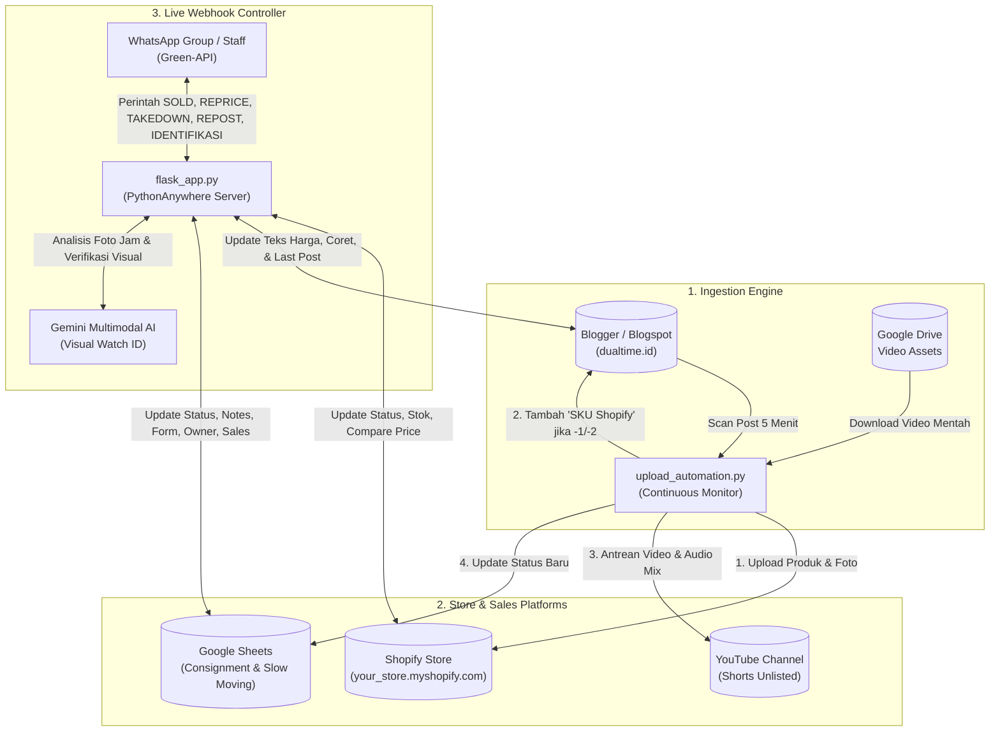
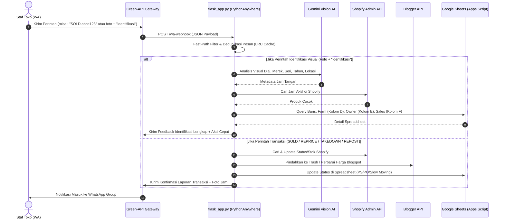

# Dualtime / IDWX Upload Automation & WhatsApp Bot

Sistem otomasi terintegrasi untuk katalog jam tangan mewah (*luxury watches*), sinkronisasi inventaris multi-platform (**Blogspot**, **Shopify**, **Google Sheets**, dan **YouTube Shorts**), serta controller operasional real-time via **WhatsApp Bot (Green-API)** yang didukung oleh **Google Gemini Multimodal Vision**.

---

## 1. Ringkasan Arsitektur Sistem (System Architecture)

Sistem terdiri dari dua subsistem utama yang saling terhubung secara terdistribusi:



1. **`upload_automation.py` (Ingestion & Upload Engine)**:  
   Memonitor postingan baru di Blogger secara otomatis setiap 5 menit, mengklasifikasikan jenis produk (`NOTSYNC`, `TWP`, `PHOTO STUDIO`, `PHOTO OWNER`), mengekstrak data katalog (judul, SKU, harga, tahun, foto resolusi tinggi), mengunggahnya ke Shopify, mengunggah video ke YouTube Shorts, serta melakukan sinkronisasi balik (*reverse-sync*) penulisan `SKU Shopify: [SKU]` pada artikel Blogspot jika SKU bertanda strip (`-1`, `-2`).
2. **`flask_app.py` (WhatsApp Bot Controller & Webhook Server)**:  
   Berjalan sebagai layanan web real-time (dihosting di PythonAnywhere) yang menerima webhook WhatsApp via Green-API untuk perintah operasional (`REPRICE`, `HARGA BARU`, `SOLD`, `ON HOLD`, `TAKEDOWN`, `REPOST`, `FOTO`, dan `IDENTIFIKASI` jam tangan visual via Gemini AI), mencari produk dengan sistem pemeringkatan cerdas (*Multi-Candidate Ranking*), dan melakukan pembaruan serentak ke Shopify, Blogspot, dan Google Sheets.

---

## 2. Fitur Utama

- **Pencarian & Ekstraksi Katalog Otomatis**: Pengambilan postingan Blogger API v3 dengan penyaringan tanggal terbit, klasifikasi format label, serta pembersihan teks HTML.
- **Dual-Layer Regex Safeguard**: Mencegah teks harga ritel (`Retail Price:`) salah diambil sebagai harga jual toko.
- **Generator SKU Unik Counter Suffix (`-1`, `-2`)**: Menangani SKU berulang di Shopify secara otomatis dengan penambahan nomor counter.
- **Reverse-Sync Idempoten ke Blogspot**: Menyisipkan baris `SKU Shopify: [SKU]` pada postingan Blogspot tanpa merusak styling HTML aslinya.
- **Otomasi YouTube Shorts**: Mengunduh video mentah dari Google Drive, menggabungkan audio BGM acak via FFMPEG, dan mengunggah ke YouTube sebagai *Unlisted Shorts*.
- **WhatsApp Webhook Bot Real-time**: Mendukung perintah cepat dengan pemisah fleksibel (`/`, `:`, `-`, atau spasi) untuk perintah `REPRICE`, `SOLD`, `ON HOLD`, `TAKEDOWN`, dan `REPOST`.
- **Identifikasi Jam Tangan Visual (Gemini Multimodal Vision)**: Kirim foto jam tangan dengan caption `identifikasi` untuk mendeteksi merek, seri, tahun, harga Shopify, lokasi ketersediaan (*Ready di Toko* / *Ready in Bali*), baris Spreadsheet, data formulir konsinyasi (Kolom D), Owner (Kolom E), dan Sales (Kolom F).
- **Algoritma Pemeringkatan Cerdas ($S_{\text{score}}$)**: Memilih produk Shopify yang paling relevan saat ada multi-kandidat SKU berulang.
- **Pembaruan Serentak 3 Database**: Eksekusi serentak pada Shopify (status & stok), Blogspot (pindah ke Sampah / perbarui harga), dan Google Sheets (tab `PHOTO STUDIO`, `PHOTO OWNER`, atau `ALL STOCK`).
- **Keandalan Ekstrim (Fail-Safe)**: Dilengkapi verifikasi status pengiriman Green-API, cadangan foto CDN Shopify, serta fallback otomatis ke format teks biasa agar laporan transaksi tidak pernah hilang.

---

## 3. Bedah Teknis Subsistem

### 3.1. Ingestion Engine (`upload_automation.py`)

#### A. Alur Kerja (Workflow)
Script berjalan dalam loop pemantauan berkala (setiap 300 detik / 5 menit):
1. **Pengambilan Tautan Artikel**: Memanggil Blogger API v3 (`status='LIVE'`), menyaring artikel hari ini dan kemarin (WIB), serta mengecek cache `processed_urls.json`.
2. **Verifikasi Label & SKU**: Wajib memiliki label `NEW ARRIVAL`. Mengekstrak SKU dasar dari teks `Code: ...` dan memvalidasi terhadap `processed_skus.json`.
3. **Klasifikasi Format Katalog**:
   - `PHOTO STUDIO`: Memiliki label `CONSIGNMENT_PS` atau `FEATURED`.
   - `PHOTO OWNER`: Memiliki label `CONSIGNMENT_PO` atau SKU berawalan `CPO`.
   - `NOTSYNC`: Memiliki label `NOTSYNC`.
   - `TWP`: Memiliki label `TWP`.

#### B. Fitur Proteksi Kritis
- **Dual-Layer Regex Safeguard**:
  ```python
  price_match = re.search(r'(?m)^\s*Price\s*:\s*([^\n]+)', body_text, re.IGNORECASE)
  if not price_match:
      price_match = re.search(r'(?<!retail\s)\bPrice\s*:\s*([^\n]+)', body_text, re.IGNORECASE)
  ```
- **Generator SKU Counter Suffix**:
  ```python
  if sku in EXISTING_SKUS:
      counter = 1
      while f"{base_sku}-{counter}" in EXISTING_SKUS:
          counter += 1
      sku = f"{base_sku}-{counter}"
  EXISTING_SKUS.add(sku)
  ```
- **Reverse-Sync ke Blogspot (`insert_shopify_sku_html`)**:
  Menyisipkan `SKU Shopify: ABC12345-1` tepat di bawah `Code: ABC12345` pada postingan Blogger dengan mempertahankan styling inline (`font-family`, `style`, warna).
- **Otomasi YouTube Shorts**: Mengunduh video dari folder Google Drive, menggabungkan lagu acak dari direktori BGM via `ffmpeg`, lalu mengunggah video ke YouTube channel sebagai *Unlisted Shorts* dan menyisipkan tautan embed ke deskripsi Shopify.

---

### 3.2. WhatsApp Bot & Webhook Server (`flask_app.py`)

#### A. Alur Eksekusi Perintah WhatsApp



#### B. Daftar Perintah Chat Lengkap

| Perintah | Contoh Format Fleksibel | Efek pada Shopify | Efek pada Blogspot | Efek pada Google Sheets |
|---|---|---|---|---|
| **`IDENTIFIKASI`** | Foto jam + `identifikasi` | Hanya baca (mencari jam AKTIF yang cocok di etalase) | Hanya baca | Menampilkan Tab, Baris, Form (Kolom D), Owner (Kolom E), Sales (Kolom F) |
| **`REPRICE`** | `REPRICE abcd123 150JT`<br>`REPRICE / abcd123 / 150.000.000` | Ubah `price` varian, pasang harga lama di `compare_at_price` | Coret harga lama (`<strike>`), pasang `Reprice: [harga]`, update `Last Post` | Ubah status ke `Reprice/post`, centang jadwal berikutnya |
| **`HARGA BARU`** | `HARGA BARU: abcd123 150JT` | Ubah `price` varian, kosongkan `compare_at_price` | Timpa langsung nilai `Price:` tanpa coret | Sama dengan Reprice |
| **`SOLD`** | `SOLD abcd123`<br>`SOLD / abcd123` | Ubah status ke `DRAFT`, set stok ke `0` | Pindahkan postingan ke Sampah (*Trash*) | Ubah status ke `Sold`, catat `SOLD (tgl)` di Kolom Notes |
| **`ON HOLD`** | `ON HOLD abcd123`<br>`HOLD: abcd123` | Ubah status ke `DRAFT`, set stok ke `0` | Pindahkan postingan ke Sampah (*Trash*) | Ubah status ke `On Hold`, catat `ON HOLD (tgl)` di Kolom Notes |
| **`TAKEDOWN`** | `TAKEDOWN abcd123` | Ubah status ke `DRAFT`, set stok ke `0` | Pindahkan postingan ke Sampah (*Trash*) | Ubah status ke `Takedown`, catat `TAKEDOWN (tgl)` di Kolom Notes |
| **`REPOST`** | `REPOST abcd123` | **Tidak ada perubahan** (tetap seperti semula) | **Postingan harus masih aktif**: perbarui tgl publish ke sekarang, pasang label `REPOST` | Ubah status ke `Reprice/post` |
| **`FOTO` / `CEK`** | `FOTO abcd123` | Tidak ada perubahan (hanya read) | Tidak ada perubahan (hanya read) | Menampilkan ringkasan status & foto resolusi tinggi ke WA |

#### C. Algoritma Pemeringkatan Cerdas (`score_shopify_candidate`)
Mengatasi masalah SKU berulang pada jam yang datang kembali (misal `XYZ98765` vs `XYZ98765-1`):

$$\text{Total Skor} = S_{\text{status}} + S_{\text{stok}} + S_{\text{base}} + S_{\text{counter}} + S_{\text{recency}} + S_{\text{blogger}}$$

- **Status Produk ($S_{\text{status}}$)**: `ACTIVE` ($+10.000$), `DRAFT` ($+0$), `ARCHIVED` ($-2.000$).
- **Counter Suffix ($S_{\text{counter}}$)**: Varian counter (`-1`, `-2`, `-3`) otomatis diprioritaskan mengalahkan produk lama:
  $$S_{\text{counter}} = +8.000 + (\text{counter\_val} \times 1.000)$$
  Jika staf mengetik eksplisit `XYZ98765-1`, kecocokan eksak mendapat bonus mutlak $+50.000$.
- **Bobot Kebaruan ($S_{\text{recency}}$)**: $\text{days\_num} \times 10$ sehingga listing tahun 2026 unggul atas arsip lama.
- **Korelasi Data Blogspot ($S_{\text{blogger}}$)**: Kesesuaian tanggal publikasi ($+4.000$) dan kemiripan judul ($+2.000$).

---

## 4. Ringkasan Sinkronisasi Antar-Platform

| Kejadian / Event | Aksi di Blogspot | Aksi di Shopify | Aksi di Google Sheets | Aksi di WhatsApp |
|---|---|---|---|---|
| **Upload jam baru bertanda -1/-2** | Sisipkan `SKU Shopify: [SKU]` di bawah `Code:` | Upload produk `ACTIVE`, stok 1, foto lengkap | - | - |
| **Perintah `REPRICE [SKU] [Harga]`** | Coret harga lama, tulis Reprice, ubah tgl publish & `Last Post` | Ubah harga varian & pasang compare price | Status ubah ke `Reprice/post` | Balas laporan detail + foto jam tangan |
| **Perintah `SOLD [SKU]`** | Pindahkan artikel ke Sampah (*Trash*) | Ubah status `DRAFT`, set stok ke `0` | Status ubah ke `Sold`, catat `SOLD (tgl)` di Kolom Notes | Balas laporan `🏷️ SOLD` + foto jam tangan |
| **Perintah `ON HOLD [SKU]`** | Pindahkan artikel ke Sampah (*Trash*) | Ubah status `DRAFT`, set stok ke `0` | Status ubah ke `On Hold`, catat `ON HOLD (tgl)` di Kolom Notes | Balas laporan `⏸️ ON HOLD` + foto jam tangan |
| **Perintah `TAKEDOWN [SKU]`** | Pindahkan artikel ke Sampah (*Trash*) | Ubah status `DRAFT`, set stok ke `0` | Status ubah ke `Takedown`, catat `TAKEDOWN (tgl)` di Kolom Notes | Balas laporan `🗑️ TAKEDOWN` + foto jam tangan |
| **Perintah `REPOST [SKU]`** | Ubah tgl publish ke sekarang agar naik ke posisi teratas, pasang label `REPOST` & `Last Post` | **Tidak ada perubahan** | Status ubah ke `Reprice/post` | Balas laporan `🔁 REPOST` + foto jam tangan |
| **Foto + `identifikasi`** | Hanya membaca postingan | Cari produk aktif & stok > 0 yang cocok | Baca Form (Kolom D), Owner (Kolom E), Sales (Kolom F) | Kirim kartu identifikasi lengkap + Aksi Cepat |

---

## 5. Struktur Repository

```text
upload-automation/
├── upload_automation.py               # Ingestion & Upload Engine (Blogger -> Shopify -> YouTube)
├── flask_app.py                       # WhatsApp Webhook Server & Controller (PythonAnywhere)
├── requirements.txt                   # Daftar dependency Python
├── .env.example                       # Template konfigurasi environment variables
├── processed_urls.json                # Cache database tautan Blogger yang sudah diproses
├── processed_skus.json                # Cache database SKU yang sudah diproses harian
├── pending_youtube_queue.json         # Antrean pemrosesan video YouTube Shorts
├── scratch/                           # Script testing, simulasi, dan file Google Apps Script (.gs)
│   ├── Code.gs                        # Webhook Apps Script untuk Tab PHOTO STUDIO & PHOTO OWNER
│   ├── WEBHOOK_SLOW_MOVING_FEATURED.gs# Webhook Apps Script untuk Tab ALL STOCK
│   ├── test_watch_identification.py   # Unit test suite untuk fitur identifikasi jam visual
│   ├── test_webhook_flow_simulation.py# Simulasi lengkap alur webhook pesan masuk
│   └── test_blogger_price_format.py   # Unit test regex harga & coret Blogger
├── Panduan_Penggunaan_*.html          # Dokumen panduan visual printable
└── README.md                          # Dokumentasi utama proyek
```

---

## 6. Tech Stack & Persyaratan Sistem

- **Bahasa & Framework**: Python 3.10+, Flask, Jinja2
- **AI & Computer Vision**: Google Gemini API (`gemini-2.0-flash`, `gemini-1.5-flash`)
- **API & Layanan Cloud**:
  - Shopify Admin API (GraphQL & REST)
  - Google Blogger API v3
  - Google Drive API v3
  - YouTube Data API v3
  - Green-API (WhatsApp Gateway)
  - Google Apps Script (Spreadsheet Webhook)
- **Library Pendukung**: `beautifulsoup4`, `requests`, `google-api-python-client`, `google-auth-oauthlib`, `pillow`
- **Multimedia**: `ffmpeg` (penggabungan audio BGM dan video YouTube Shorts)

---

## 7. Panduan Instalasi Lokal

1. **Clone repository**:
   ```bash
   git clone https://github.com/darrellrafa/upload-automation.git
   cd upload-automation
   ```

2. **Buat environment virtual**:
   ```bash
   python3 -m venv .venv
   source .venv/bin/activate    # Di Linux / macOS
   # .venv\Scripts\activate     # Di Windows
   ```

3. **Install dependencies**:
   ```bash
   pip install -r requirements.txt
   ```

4. **Konfigurasi file `.env`**:
   Salin `.env.example` menjadi `.env` lalu lengkapi kredensial Anda:
   ```bash
   cp .env.example .env
   ```

5. **Menjalankan Script**:
   - Menjalankan upload automation:
     ```bash
     python upload_automation.py
     ```
   - Menjalankan webhook server lokal:
     ```bash
     python flask_app.py
     ```

---

## 8. Panduan Setup & Deployment di PythonAnywhere

Panduan ini ditujukan untuk deployment di server PythonAnywhere (contoh domain: `<username>.pythonanywhere.com`).

### 8.1. Struktur Direktori di Server

```text
/home/<username>/
├── upload-automation/               <-- Root direktori Git repository
│   ├── .env                         <-- File environment berisi kredensial rahasia
│   ├── flask_app.py                 <-- Entry point aplikasi web
│   ├── upload_automation.py         <-- Script otomasi upload continuous
│   ├── requirements.txt             <-- Daftar dependency Python
│   └── ...
└── .virtualenvs/
    └── idwx_env/                    <-- Virtual environment Python 3.10
```

### 8.2. Langkah 1: Clone Repository & Buat Virtualenv
Buka **Bash Console** di dashboard PythonAnywhere:
```bash
# 1. Pindah ke direktori home
cd /home/<username>

# 2. Clone repository
git clone https://github.com/darrellrafa/upload-automation.git
cd upload-automation

# 3. Buat virtual environment dengan Python 3.10
mkvirtualenv idwx_env --python=python3.10

# 4. Install seluruh library yang dibutuhkan
pip install -r requirements.txt
```

### 8.3. Langkah 2: Konfigurasi File `.env`
Edit file `.env` di dalam folder server:
```bash
nano /home/<username>/upload-automation/.env
```
Isi konfigurasi berikut:
```env
# Google OAuth Kredensial (Blogger, Drive, YouTube)
GCP_CLIENT_ID="your_google_client_id.apps.googleusercontent.com"
GCP_CLIENT_SECRET="your_google_client_secret"
GCP_REFRESH_TOKEN="your_google_refresh_token"
BLOG_ID="your_blogger_blog_id"

# Shopify Admin API Kredensial
SHOPIFY_STORE_NAME="your_shopify_store_name"
SHOPIFY_CLIENT_ID="your_shopify_client_id"
SHOPIFY_CLIENT_SECRET="your_shopify_client_secret"

# WhatsApp Bot Gateway (Green-API)
GREEN_API_ID_INSTANCE="your_green_api_id_instance"
GREEN_API_API_TOKEN="your_green_api_api_token"
TARGET_GROUP_ID="your_target_group_ids"

# Google AI Studio (Gemini Vision Multimodal)
GEMINI_API_KEY="your_gemini_api_key"

# Webhook Google Apps Script Spreadsheet
WEBHOOK_CONSIGNMENT_LISTING="https://script.google.com/macros/s/.../exec"
WEBHOOK_SLOW_MOVING_FEATURED="https://script.google.com/macros/s/.../exec"
WEBHOOK_HISTORY_FOTO_STUDIO="https://script.google.com/macros/s/.../exec"

# YouTube BGM Library Folder di Google Drive
DRIVE_AUDIO_FOLDER_ID="your_drive_audio_folder_id"
```
Simpan dengan menekan `Ctrl + O` lalu keluar dengan `Ctrl + X`.

### 8.4. Langkah 3: Konfigurasi Web App di PythonAnywhere
1. Masuk ke tab **Web** di menu atas dashboard PythonAnywhere.
2. Klik **Add a new web app** (pilih **Manual configuration**, versi **Python 3.10**).
3. Atur path direktori:
   - **Source code**: `/home/<username>/upload-automation`
   - **Working directory**: `/home/<username>/upload-automation`
   - **Virtualenv**: `/home/<username>/.virtualenvs/idwx_env`
4. Buka **WSGI configuration file** (klik link `/var/www/<username>_pythonanywhere_com_wsgi.py`):
   Ganti seluruh isinya dengan:
   ```python
   import sys
   import os

   project_home = '/home/<username>/upload-automation'
   if project_home not in sys.path:
       sys.path.insert(0, project_home)

   from flask_app import load_env_file
   load_env_file(os.path.join(project_home, '.env'))

   from flask_app import app as application
   ```
5. Simpan file WSGI, lalu klik tombol hijau besar: **Reload <username>.pythonanywhere.com**.

### 8.5. Langkah 4: Hubungkan Webhook Green-API
1. Buka console instance Green-API Anda.
2. Masuk ke menu **Webhook Settings**:
   - **URL Webhook**: `https://<username>.pythonanywhere.com/wa-webhook`
   - **Incoming Webhook**: Centang `incomingMessageReceived`
   - **Status Webhook**: Non-aktifkan (atau biarkan, ditangani dalam <1ms oleh fast-path).
3. Simpan pengaturan.

### 8.6. Langkah 5: Menjalankan `upload_automation.py` di Background
Di tab **Tasks** PythonAnywhere:
- **Opsi Always-on task**:
  ```bash
  /home/<username>/.virtualenvs/idwx_env/bin/python /home/<username>/upload-automation/upload_automation.py
  ```
- **Opsi Background via Bash Console**:
  ```bash
  workon idwx_env
  cd /home/<username>/upload-automation
  nohup python upload_automation.py > upload.log 2>&1 &
  ```

### 8.7. Prosedur Pembaruan Kode (SOP Update)
Setiap kali ada pembaruan kode di GitHub:
```bash
cd /home/<username>/upload-automation
git pull origin main
touch /var/www/<username>_pythonanywhere_com_wsgi.py
```

---

## 9. Maintainer & Catatan Keamanan

- **Maintainer**: Darrell Rafa
- **Keamanan Kredensial**: File `.env` dilarang keras di-commit ke repository publik. Selalu gunakan `.env.example` sebagai referensi.
- **Integritas Database**: Semua perintah webhook WhatsApp melewati validasi ganda (identifikasi SKU ketat, verifikasi status stok, dan rekonsiliasi Blogspot-Shopify) demi mencegah salah ubah status atau salah hapus data.
