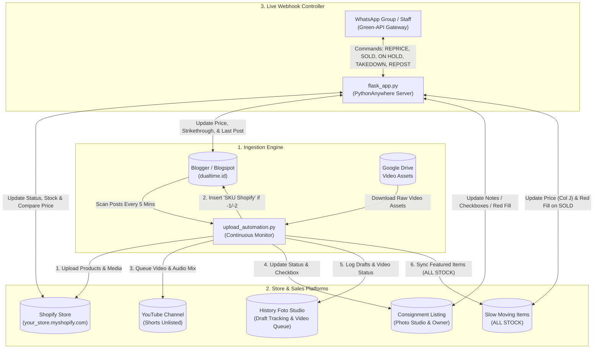
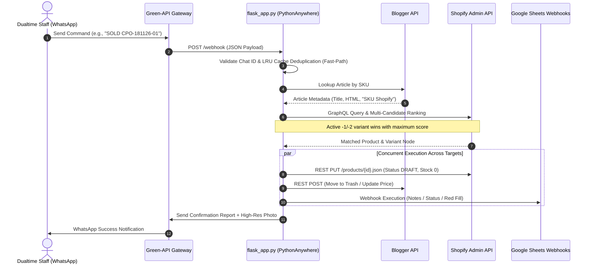

# TECHNICAL ARCHITECTURE REPORT & PYTHONANYWHERE SETUP GUIDE
**Dualtime Indonesia Automation System**  
*Technical Specification, Data Flow Architecture, and Deployment Procedures*

---

## 1. Executive Summary

The Dualtime Indonesia catalog and sales automation system consists of two distributed, interconnected core subsystems:



1. **`upload_automation.py` (Ingestion & Upload Engine)**  
   Continuously monitors new articles on Blogspot (every 300 seconds / 5 minutes), classifies product categories, extracts catalog metadata (title, SKU, price, year, high-resolution imagery), uploads them to Shopify, processes and publishes videos to YouTube Shorts, and performs automated **reverse-sync** to inject `SKU Shopify: [SKU]` into Blogspot articles when counter suffixes (`-1`, `-2`) are generated.
2. **`flask_app.py` (WhatsApp Bot Controller & Webhook Server)**  
   Operates as a high-availability real-time web service (hosted on PythonAnywhere) receiving incoming text commands from WhatsApp via Green-API (`REPRICE`, `SOLD`, `ON HOLD`, `TAKEDOWN`, `REPOST`, and `FOTO`), identifies the exact product using an intelligent **Multi-Candidate Ranking Algorithm**, and performs simultaneous atomic updates across Shopify, Blogspot, and 3 targeted Google Spreadsheets.

---

## 2. Technical Deep Dive: `upload_automation.py`

### 2.1. Core Workflow
The script operates in a continuous monitoring loop:

1. **Article Fetching**:
   - Calls Blogger API v3 (`posts().list(maxResults=20, status='LIVE')`).
   - Filters articles published today and yesterday (WIB / Western Indonesia Time).
   - Validates post URLs against the persistent local cache `processed_urls.json`. If an article URL has already been processed, it is skipped immediately without redundant API queries.
2. **Label & SKU Verification**:
   - Requires the `NEW ARRIVAL` label. Articles without this label are bypassed.
   - Extracts the base SKU from the article content via `Code: ...`. Prevents duplicate processing within the current execution session via `PROCESSED_SKUS`.
3. **Catalog Format Classification**:
   - **`PHOTO OWNER`**: Articles containing `CONSIGNMENT_PO` label or an SKU starting with `CPO`.
   - **`PHOTO STUDIO`**: Articles containing `CONSIGNMENT_PS` or `FEATURED` label.
   - **`NOTSYNC`**: Articles with `NOTSYNC` label (processed locally without Shopify synchronization).
   - **`TWP`**: The Watch Project internal inventory format.

---

### 2.2. Critical Safeguards & Production Logic

#### A. Dual-Layer Regex Safeguard (Price Misidentification Prevention)
Prevents extracting manufacturer retail prices (e.g., `Retail Price: Rp 200,000,000`) instead of the store's actual offering price:
```python
price_match = re.search(r'(?m)^\s*Price\s*:\s*([^\n]+)', body_text, re.IGNORECASE)
if not price_match:
    price_match = re.search(r'(?<!retail\s)\bPrice\s*:\s*([^\n]+)', body_text, re.IGNORECASE)
```

#### B. Unique Counter Suffix SKU Generator (`-1`, `-2`, `-3`)
Used when previously sold watches return to inventory or when duplicate reference codes exist:
```python
if sku in EXISTING_SKUS:
    counter = 1
    while f"{base_sku}-{counter}" in EXISTING_SKUS:
        counter += 1
    sku = f"{base_sku}-{counter}"
EXISTING_SKUS.add(sku)
```

#### C. Automated Reverse-Sync to Blogspot (`insert_shopify_sku_html`)
When a watch is uploaded with a counter suffix (e.g., `ABC12345-1`), the engine patches the live Blogspot post HTML via `posts().patch()`:
```html
<!-- Before -->
<div style="font-family: Times;">Code: ABC12345 (Customer A)</div>
<div style="font-family: Times;">Last Post: 17 Nov 2026</div>

<!-- After Automated Reverse-Sync Insertion -->
<div style="font-family: Times;">Code: ABC12345 (Customer A)</div>
<div style="font-family: Times;">SKU Shopify: ABC12345-1</div>
<div style="font-family: Times;">Last Post: 17 Nov 2026</div>
```
> [!NOTE]
> `insert_shopify_sku_html` is fully **idempotent** and replicates the exact parent container CSS attributes (`font-family`, `style`, `color`, etc.), preventing layout distortion and duplicate injections.

#### D. Idempotent Media Reconciliation (`reconcile_shopify_product_images`)
Ensures all extracted high-resolution watch images are fully uploaded to Shopify CDN by performing post-creation asset verification and reconciliation.

#### E. YouTube Shorts Automation & Dynamic Audio Mixing
When an article includes a Google Drive video folder link, the engine queues the task into `pending_youtube_queue.json`, downloads the raw `.mp4` footage, overlays a randomly chosen background track via `ffmpeg`, publishes to YouTube as an **Unlisted Short**, and automatically embeds the iframe player into the Shopify product description.

---

## 3. Technical Deep Dive: `flask_app.py`

### 3.1. Webhook Architecture & Resilience



- **Message Deduplication (LRU Cache)**: Prevents accidental duplicate execution when Green-API retries webhook delivery during network fluctuations.
- **Sub-Millisecond Fast-Path Filter (<1 ms)**: Non-message events (e.g., `deviceStatus`, `outgoingMessageStatus`) are acknowledged with `HTTP 200` instantly without database or API overhead.
- **Always 200 OK Architecture**: Internal execution errors are caught, logged, and surfaced as human-readable diagnostic messages on WhatsApp rather than throwing HTTP 500, avoiding aggressive Green-API retry loops.

---

### 3.2. Supported WhatsApp Commands

| Command | Flexible Syntax | Shopify Action | Blogspot Action | Google Sheets Action |
|---|---|---|---|---|
| **`REPRICE`** | `REPRICE XYZ98765 150JT`<br>`REPRICE / XYZ98765 / 150000000` | Updates variant `price`, sets old price in `compare_at_price` | Strikethrough old price (`<strike>`), appends `Reprice: [price]`, updates `Last Post: [date]` | Consignment: updates status to `Reprice/post`, appends Notes.<br>Slow Moving: directly overwrites Col J (`PRICE`). |
| **`HARGA BARU`** | `HARGA BARU: XYZ98765 150JT` | Updates variant `price`, clears `compare_at_price` | Directly overwrites `Price:` text without strikethrough | Identical to Reprice |
| **`SOLD`** | `SOLD XYZ98765`<br>`SOLD / XYZ98765` | Sets status to `DRAFT`, resets inventory to `0` | Moves article to Trash | Consignment: status `Sold`, notes `SOLD (date)`.<br>Slow Moving (`ALL STOCK`): status `SOLD`, **Columns D to L turn RED (`#ea4335`)**. |
| **`ON HOLD`** | `ON HOLD XYZ98765`<br>`HOLD: XYZ98765` | Sets status to `DRAFT`, resets inventory to `0` | Moves article to Trash | Consignment: status `On Hold`, notes `ON HOLD (date)`.<br>Slow Moving (`ALL STOCK`): status `ON HOLD`, **Columns D to L turn RED (`#ea4335`)**. |
| **`TAKEDOWN`** | `TAKEDOWN XYZ98765` | Sets status to `DRAFT`, resets inventory to `0` | Moves article to Trash | Consignment: status `Takedown`, removes unticked schedule checkboxes.<br>Slow Moving: status `TAKEDOWN`. |
| **`REPOST`** | `REPOST XYZ98765` | **No change** (remains as is) | **Post must be live**: bumps publish date to now, appends `REPOST` tag & `Last Post` date | Consignment: status `Reprice/post`, ticks next schedule box. |
| **`FOTO` / `CEK`** | `FOTO XYZ98765` | Read-only inspection | Read-only inspection | Retrieves watch metadata & sends high-resolution image to WhatsApp group. |

---

### 3.3. Multi-Candidate Ranking Algorithm (`score_shopify_candidate`)

Luxury watch retailers frequently reuse code prefixes across different consignments or re-acquisitions (e.g., watch `XYZ98765` sold in 2024 returns in 2026 as `XYZ98765-1`).

When a staff member simply types `SOLD XYZ98765`, the system computes an evaluation score across all matched candidate products:

$$\text{Total Score} = S_{\text{status}} + S_{\text{stock}} + S_{\text{base}} + S_{\text{counter}} + S_{\text{recency}} + S_{\text{blogger}}$$

1. **Live Product Status ($S_{\text{status}}$)**:
   - `ACTIVE`: $+10,000$ points
   - `DRAFT`: $+0$ points
   - `ARCHIVED`: $-2,000$ points
2. **Newer Generation Counter Priority ($S_{\text{counter}}$)**:
   - When a base SKU (`XYZ98765`) is typed, counter variants (`-1`, `-2`, `-3`) receive a dominant boost:
     $$S_{\text{counter}} = +8,000 + (\text{counter\_val} \times 1,000)$$
     *(Guarantees `-2` outranks `-1`, and `-1` outranks the legacy base listing).*
   - Base SKU without hyphen receives baseline $+100$.
   - If user explicitly inputs `XYZ98765-1`, the exact match receives an absolute boost of $+50,000$.
3. **Publication Recency Weight ($S_{\text{recency}}$)**:
   - Evaluated as $\text{days\_num} \times 10$, giving 2026 listings substantial advantage over 2024/2025 archived items.
4. **Blogspot Correlation ($S_{\text{blogger}}$)**:
   - Matching creation dates between Shopify and Blogger: $+4,000$ points.
   - Title similarity bonus: up to $+2,000$ points.

---

## 4. Google Sheets 3-Spreadsheet Target Architecture

The automation communicates with three distinct Google Apps Script Webhooks:

```text
├── 1. WEBHOOK_CONSIGNMENT_LISTING  (Spreadsheet: Consignment Listing)
│   ├── Tab 'PHOTO STUDIO'         --> Initial upload sync, status updates, schedule checkboxes
│   └── Tab 'PHOTO OWNER'          --> Initial 'WEB' checkbox, status updates, notes
│
├── 2. WEBHOOK_HISTORY_FOTO_STUDIO  (Spreadsheet: History Foto Studio)
│   └── Tab 'History Foto Studio'  --> New watch draft logging & YouTube video rendering queue
│
└── 3. WEBHOOK_SLOW_MOVING_FEATURED (Spreadsheet: Stock List Slow Moving Items)
    └── Tab 'ALL STOCK' (Exclusive) --> 13-column stock tracking, Col C empty on upload, Col D-L Red on SOLD, Reprice updates Col J and resets fill
```

### Exact 13-Column Layout of Tab `ALL STOCK`

| Col | Header / Field | Behavior on Initial Upload | Behavior on REPRICE / Status Update |
|:---:|:---|:---|:---|
| **A** | *Cyan Indicator* | Kept empty `""` (cyan fill and border format copied from above) | Unchanged |
| **B** | **DATE** | Today's date (`dd/mm/yyyy`, e.g., `18/11/2026`) | Unchanged |
| **C** | **STATUS** | **STRICTLY EMPTY (`""`)** upon upload | Updated to `"REPRICE"`, `"SOLD"`, or `"TAKEDOWN"` |
| **D** | **NO** | Auto-incremented sequence number (`prevNo + 1`, e.g., 55 $\to$ **56**) | Retained on updates |
| **E** | **OWNER** | Consignor code (`AH`, `OMNI`, `ONELUXE`, `PT BESAR`, etc.) | Unchanged |
| **F** | **BRAND** | Brand / Series (`ROLEX`, `PATEK PHILIPPE`, `SEAMASTER`) | Unchanged |
| **G** | **DESCRIPTION** | Model description without year (e.g., `5167A`) | Unchanged |
| **H** | **YEAR** | Year / Warranty (`2021`, `2022`, `OCT 2025`) | Unchanged |
| **I** | **CONDITION** | Condition rating (`UNWORN`, `VERY MINT`, `LIKE NEW`) | Unchanged |
| **J** | **PRICE** | Pure numeric formatted with `#,##0` (e.g., `76,000,000`) | **Directly overwritten with new numeric price** (No notes column) |
| **K** | **REFERENCE** | Watch reference number (e.g., `5167A-001`) | Unchanged |
| **L** | **SERIAL NUMBER** | SKU / Case Serial Number (Unique search key) | Lookup key |
| **M** | **LINK WEBSITE** | Article URL on dualtime.id | Unchanged |

> [!IMPORTANT]
> **Special Rule for SOLD and ON HOLD Status on `ALL STOCK`**:  
> When a watch is marked `SOLD` or `ON HOLD`:
> 1. Column C is set to `"SOLD"` or `"ON HOLD"`.
> 2. **Columns D through L (Cols 4 to 12) have their fill color set to RED (`#ea4335`)**.
> 3. Columns A, B, C, and M retain their original formatting.

---

## 5. PythonAnywhere Setup & Deployment Guide

This guide applies to any standard PythonAnywhere account (example domain: `<username>.pythonanywhere.com`).

### 5.1. Server Directory Structure

```text
/home/<username>/
├── upload-automation/               <-- Root Git repository directory
│   ├── .env                         <-- Environment file containing secret credentials
│   ├── flask_app.py                 <-- Web application entry point (WhatsApp bot)
│   ├── upload_automation.py         <-- Continuous upload daemon
│   ├── requirements.txt             <-- Python package dependencies
│   ├── processed_urls.json          <-- Persistent URL cache
│   ├── processed_skus.json          <-- Persistent SKU cache
│   └── pending_youtube_queue.json   <-- Video processing queue
└── .virtualenvs/
    └── idwx_env/                    <-- Python 3.10 virtual environment
```

---

### 5.2. Step 1: Clone Repository & Create Virtualenv

Open a **Bash Console** in your PythonAnywhere dashboard:

```bash
# 1. Navigate to home directory
cd /home/<username>

# 2. Clone the repository (first-time setup)
git clone https://github.com/darrellrafa/upload-automation.git
cd upload-automation

# 3. Create a dedicated Python 3.10 virtual environment
mkvirtualenv idwx_env --python=python3.10

# 4. Install all required dependencies
pip install -r requirements.txt
```

---

### 5.3. Step 2: Configure Environment Variables (`.env`)

Create or edit the `.env` file inside `/home/<username>/upload-automation/.env`:

```bash
nano /home/<username>/upload-automation/.env
```

Paste your configuration:

```env
# Google OAuth Credentials (Blogger, Drive, YouTube)
GCP_CLIENT_ID="your_google_client_id.apps.googleusercontent.com"
GCP_CLIENT_SECRET="your_google_client_secret"
GCP_REFRESH_TOKEN="your_google_refresh_token"
BLOG_ID="your_blogger_blog_id"

# Shopify Admin API Credentials
SHOPIFY_STORE_NAME="your_shopify_store_name"
SHOPIFY_CLIENT_ID="your_shopify_client_id"
SHOPIFY_CLIENT_SECRET="your_shopify_client_secret"

# WhatsApp Bot Gateway (Green-API)
GREEN_API_ID_INSTANCE="your_green_api_id_instance"
GREEN_API_API_TOKEN="your_green_api_api_token"
TARGET_GROUP_ID="your_target_whatsapp_group_id"

# Google Apps Script Webhooks (3 Target Spreadsheets)
WEBHOOK_CONSIGNMENT_LISTING="https://script.google.com/macros/s/your_consignment_script_id/exec"
WEBHOOK_HISTORY_FOTO_STUDIO="https://script.google.com/macros/s/your_history_script_id/exec"
WEBHOOK_SLOW_MOVING_FEATURED="https://script.google.com/macros/s/your_slow_moving_script_id/exec"

# YouTube BGM Library Folder on Google Drive
DRIVE_AUDIO_FOLDER_ID="your_drive_audio_folder_id"
```

Save with `Ctrl + O`, then exit with `Ctrl + X`.

---

### 5.4. Step 3: Configure Web App in PythonAnywhere Dashboard

1. Navigate to the **Web** tab in the PythonAnywhere top menu.
2. If not yet created, click **Add a new web app**:
   - Choose **Manual configuration (not Django)**.
   - Select Python version: **Python 3.10**.
3. On the Web configuration panel, set:
   - **Source code**: `/home/<username>/upload-automation`
   - **Working directory**: `/home/<username>/upload-automation`
   - **Virtualenv**: `/home/<username>/.virtualenvs/idwx_env`
4. Click to edit the **WSGI configuration file** (`/var/www/<username>_pythonanywhere_com_wsgi.py`):
   - Replace the entire template contents with:

```python
import sys
import os

# 1. Register project root to sys.path
project_home = '/home/<username>/upload-automation'
if project_home not in sys.path:
    sys.path.insert(0, project_home)

# 2. Load environment variables from .env
from flask_app import load_env_file
load_env_file(os.path.join(project_home, '.env'))

# 3. Export Flask application object as 'application' (WSGI standard)
from flask_app import app as application
```

5. Click **Save** in the top-right corner.
6. Return to the **Web** tab and click the green button: **Reload <username>.pythonanywhere.com**.

---

### 5.5. Step 4: Connect Green-API Webhook

1. Open your Green-API instance dashboard.
2. Navigate to **Webhook Settings**:
   - **Webhook URL**: `https://<username>.pythonanywhere.com/webhook`
   - **Incoming Webhook**: Enable `incomingMessageReceived`.
   - **Outgoing / Status Webhook**: Disable or leave as is (safely handled by sub-millisecond fast-path).
3. Save settings. Send a test message in your target WhatsApp group:
   ```text
   FOTO XYZ98765
   ```
   The bot will reply in 1–3 seconds with the full status summary and high-resolution watch photograph.

---

### 5.6. Step 5: Running `upload_automation.py`

#### Option A: Always-On Tasks (Recommended for Paid PythonAnywhere Accounts)
1. Go to the **Tasks** tab.
2. Under **Always-on tasks**, configure:
   ```bash
   /home/<username>/.virtualenvs/idwx_env/bin/python /home/<username>/upload-automation/upload_automation.py
   ```
3. Click **Create**. PythonAnywhere will supervise the process 24/7 and auto-restart it if an unexpected process termination occurs.

#### Option B: Background Console via Nohup (Alternative)
From a Bash Console:
```bash
workon idwx_env
cd /home/<username>/upload-automation
nohup python upload_automation.py > upload.log 2>&1 &
```

---

### 5.7. Standard Maintenance & Update SOP

Whenever code updates are pushed to GitHub:

```bash
# 1. Open Bash Console on PythonAnywhere
cd /home/<username>/upload-automation

# 2. Pull the latest commits
git pull origin main

# 3. Gracefully reload the WSGI worker without manual browser clicks
touch /var/www/<username>_pythonanywhere_com_wsgi.py
```

---

## 6. Comprehensive Cross-Platform Synchronization Matrix

| Trigger / User Event | Action on Blogspot | Action on Shopify | Action on Google Sheets | Action on WhatsApp |
|---|---|---|---|---|
| **Upload new watch with `-1`/`-2` counter suffix** | Injects `SKU Shopify: [SKU]` directly under `Code:` | Uploads `ACTIVE` product, inventory 1, full media assets | Logs to Consignment Listing & History Foto Studio | - |
| **Staff sends `REPRICE ABC12345 1.4M`** | Strikes out old price, appends new price, updates `Last Post` date | Updates variant price & sets `compare_at_price` | Consignment: status `Reprice/post`, appends Notes.<br>Slow Moving: directly overwrites Col J (`PRICE`). | Sends detailed report + high-res photo |
| **Staff sends `SOLD ABC12345`** | Moves article to Trash | Sets status to `DRAFT`, inventory to `0` | Consignment: status `Sold`, notes `SOLD (date)`.<br>Slow Moving (`ALL STOCK`): status `SOLD`, **Cols D to L turn RED (`#ea4335`)**. | Sends `🏷️ LAPORAN SOLD` + photo |
| **Staff sends `ON HOLD ABC12345`** | Moves article to Trash | Sets status to `DRAFT`, inventory to `0` | Consignment: status `On Hold`, notes `ON HOLD (date)`.<br>Slow Moving (`ALL STOCK`): status `ON HOLD`, **Cols D to L turn RED (`#ea4335`)**. | Sends `⏸️ LAPORAN ON HOLD` + photo |
| **Staff sends `TAKEDOWN ABC12345`** | Moves article to Trash | Sets status to `DRAFT`, inventory to `0` | Consignment: status `Takedown`, unticks schedule boxes.<br>Slow Moving: status `TAKEDOWN`. | Sends `🗑️ LAPORAN TAKEDOWN` + photo |
| **Staff sends `REPOST ABC12345`** | Bumps publish date to current time to bring post to top, adds `REPOST` tag | **No change** | Consignment: status `Reprice/post`, ticks next schedule box. | Sends `🔁 LAPORAN REPOST` + photo |

